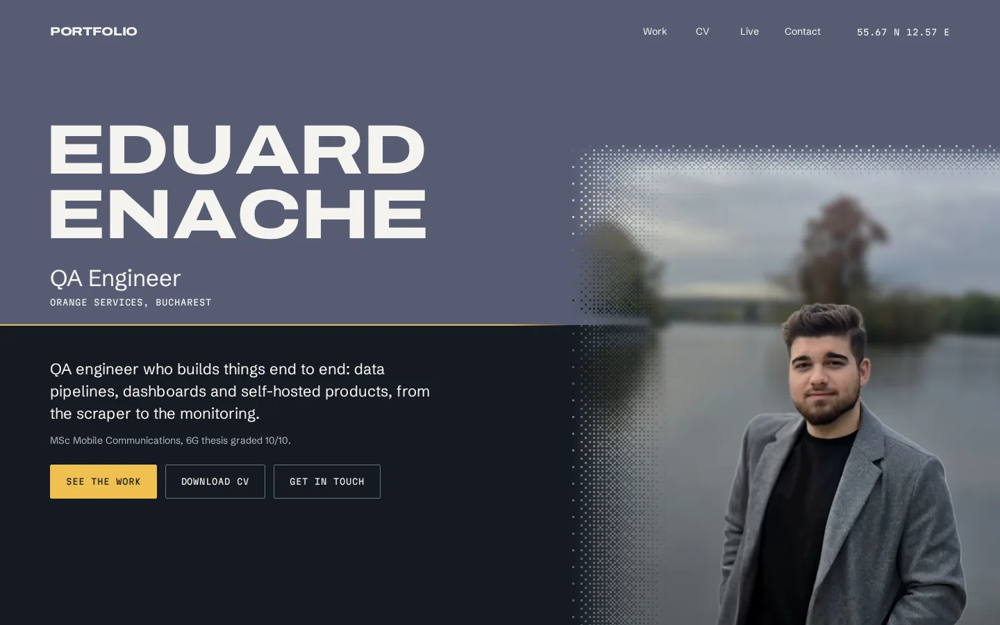
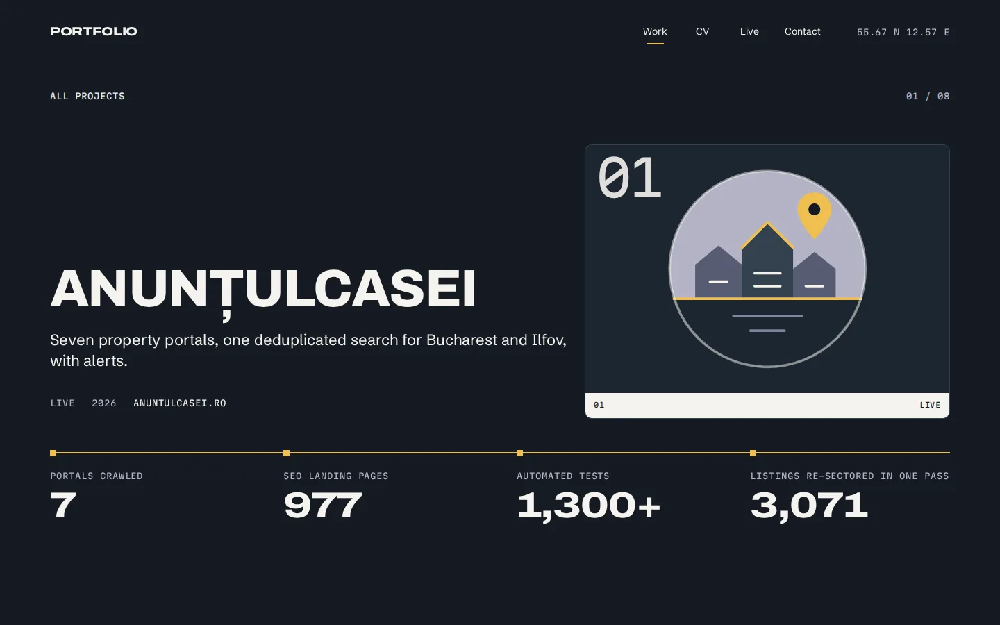
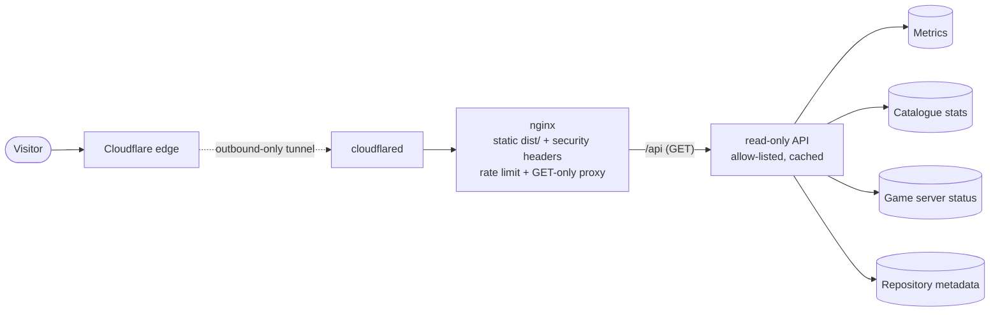

<div align="center">


<sub><a href="https://eduardenache.ro"><b>Live site</b></a> &nbsp;·&nbsp; <a href="#-architecture">Architecture</a> &nbsp;·&nbsp; <a href="#-run-it-locally">Run it locally</a> &nbsp;·&nbsp; <a href="#-security">Security</a></sub>

</div>

<br/>

> My interactive CV and portfolio: one page per project, a card fan that opens each project through its emblem,
> and a **Live** page whose numbers come from services I run myself.

<p align="center">
  
  
</p>

## ◆ &nbsp;What it is

A static site with a small read-only API behind it.

- **Landing, CV, eight project pages, contact form.** Pages are complete without JavaScript; the motion
  (GSAP scenes, Lenis scrolling, dither dissolves, View Transitions between pages) layers on top and falls back to a
  calm static version under `prefers-reduced-motion`.
- **Live page and per-project live strips.** Server health, catalogue and crawler stats, game-server status and
  repository activity, fetched from the API and cached, with an offline fallback when it cannot be reached.
- **Palette and type** taken from one photograph (dusk over a harbour): slate, haze, gold and off-white, Archivo
  and Martian Mono. Every design token lives in `src/styles/tokens.css`.

## ◆ &nbsp;Architecture



| Part | Where | Notes |
| --- | --- | --- |
| Site | `src/`, `astro.config.mjs` | Astro static output, content collections for projects and the CV |
| Web tier | `nginx/` | Serves `dist/`, sends the CSP and security headers, rate-limits and proxies `/api` |
| API | `api/` | Plain Node, no dependencies, tested with `node --test` |
| Deploy | `api/docker-compose.yml`, `scripts/` | Containers on one private network; the tunnel only makes outbound connections |

## ◆ &nbsp;Run it locally

```sh
npm install
npm run dev       # dev server on loopback
npm run build     # static site in dist/
npm run preview   # serve dist/
npm run check     # astro check (types)
(cd api && npm test)
```

Optional build-time variables (see `.env.example`): `PUBLIC_API_BASE` is the API base URL (unset shows the offline
fallback on the Live page); `PUBLIC_CONTACT_ENDPOINT` is the form target (unset falls back to a mailto link).
The API reads its sources from `api/.env` (see `api/.env.example`).

Where to change things: projects in `src/content/projects/*.md`, the CV in `src/content/cv.json`, name and links in
`src/data/site.ts`, motion in `src/scripts/`, screenshots in `design/assets/projects/`.

## ◆ &nbsp;Security

- **Read-only API.** `GET`, `HEAD` and `OPTIONS` only; everything else is `405`. Responses are built from an
  allow-list of fields, so no addresses, hostnames, tokens or personal data can leave. `api/leakcheck.sh` greps the
  live responses for private ranges and secrets.
- **Rate limits** in two layers: nginx per client address, and the API per client address. The client address is
  only trusted from the tunnel and web containers' fixed peers, so a forged forwarding header changes nothing.
- **Strict CSP** generated at build time from the actual inline scripts, plus HSTS, `Permissions-Policy`,
  `X-Content-Type-Options` and a locked-down referrer policy.
- **Hardened containers:** read-only root filesystem, all capabilities dropped, `no-new-privileges`, memory limits,
  non-root users. The tunnel has no published ports.
- **Secrets** stay in untracked `.env` files; only `.env.example` files with placeholders are committed.

<br/>

<div align="center">
<sub>Built by <a href="https://github.com/EduardEnache"><b>Eduard-Florentin Enache</b></a> &nbsp;·&nbsp; QA engineer who builds things end to end</sub>

</div>
